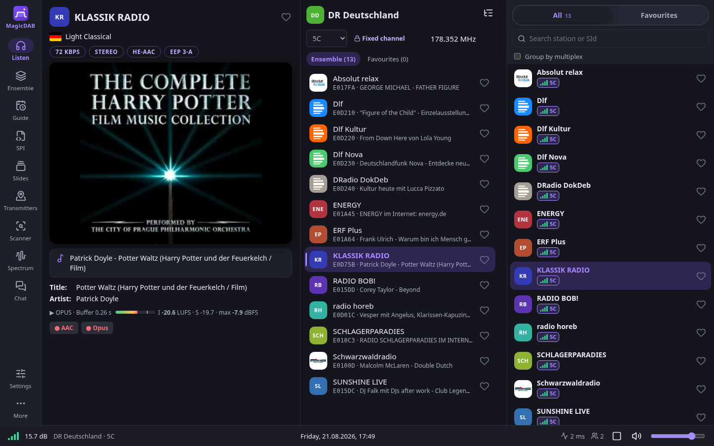
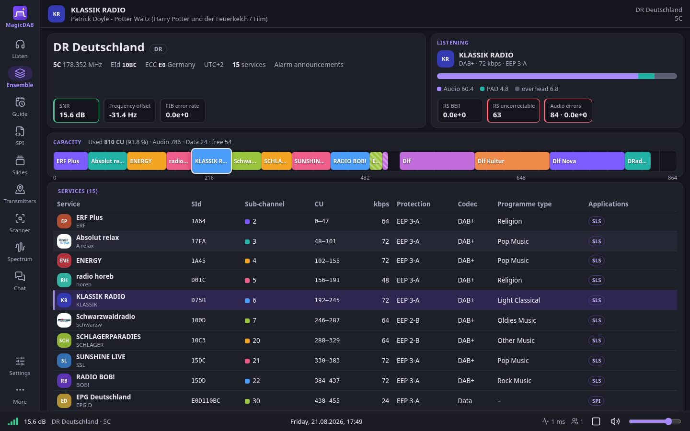
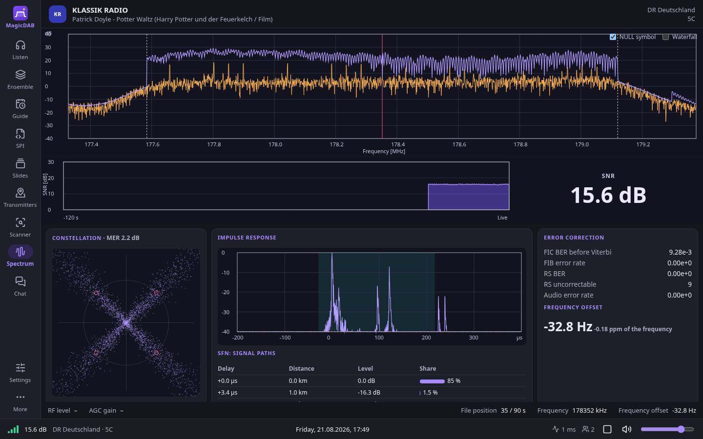

#  MagicDAB

A DAB/DAB+ receiver with a web interface. One receiver serves many
listeners in the browser, each on the station of their choice.

- **Inputs:** RTL-SDR, rtl_tcp, HackRF One, DTR-100, ETI/EDI streams, raw
  IQ recordings.
- **Decoding:** written from scratch in Rust: OFDM, FIC/MSC, DAB+,
  slideshow, DLS/DL+, SPI/EPG, TII.
- **DX:** band scan and DX scan, TII with a transmitter database and map, a
  change log of the multiplexes (also to Discord), ETI recordings of
  multiplexes heard for the first time and a report of their first minute
  (mean and peak SNR, transmitters by TII with distance and bearing).
- **Extras:** RadioDNS and RadioVIS, DAB/FM service following with an
  FM-DX-Tuner (TEF668x), loudness meter (EBU R128), public tunnel; on the
  computer it runs on the program plays the sound itself (Windows, Linux
  desktop, Android), the browser decodes nothing.
- **Packages:** Docker, Linux, Windows application with updates, Android app
  (an RTL-SDR stick on USB OTG), macOS (untested).

<p>
  <a href="https://github.com/techkrzysiek/MagicDAB/releases/latest"></a>
  <a href="https://github.com/techkrzysiek/MagicDAB/releases/latest"></a>
  <a href="https://github.com/techkrzysiek/MagicDAB/releases/latest"></a>
  <a href="https://github.com/techkrzysiek/MagicDAB/pkgs/container/magicdab"></a>
</p>



| Ensemble | Spectrum |
|---|---|
|  |  |

## Star History

<a href="https://www.star-history.com/#techkrzysiek/magicdab&Date">
  <picture>
    <source media="(prefers-color-scheme: dark)" srcset="https://api.star-history.com/svg?repos=techkrzysiek/magicdab&type=Date&theme=dark">
    
  </picture>
</a>


## Supported tuners and inputs

| Input | Notes |
|---|---|
| RTL-SDR USB sticks (RTL2832U with R820T / R828D) | e.g. RTL-SDR Blog V3 and V4, with bias-T; the packages bring librtlsdr 2.0.3 (osmocom), the Windows one also Zadig |
| rtl_tcp | an RTL-SDR on another computer, over the network |
| HackRF One | receive only, the amplifier always off, fixed LNA and VGA gains (`--hackrf`); Linux and Docker (libhackrf) |
| DTR-100 / wRadio C100 USB DAB+ dongle | the dongle demodulates by itself: no spectrum, TII, DX scan or gain control |
| ETI / EDI streams | `eti+tcp://host:port`, `edi+tcp://host:port`, mapped to channels |
| IQ recordings | `.uff`, raw u8 / s16 at 2.048 MS/s, played as channels |
| FM-DX-Tuner (TEF668x) | FM only, for DAB/FM service following |

## Running

- Port: 3222, DAB+ on a phone's keys (8080 is often FM-DX-Webserver's on
  the same computer); an installation from before 0.3.23 keeps 8080,
  `--listen` sets another one.
- Docker: see [Docker on Linux](#docker-on-linux) below. The image is
  `ghcr.io/techkrzysiek/magicdab` (x64 and arm64), the server alone.
- Windows: download `MagicDAB-<version>-windows-x64.zip` from
  [the latest release](https://github.com/techkrzysiek/MagicDAB/releases/latest),
  unpack the whole zip and start `magicdab.exe`. The RTL-SDR stick needs the
  WinUSB driver once: Zadig is in the zip (see `README.txt` there).
- Linux (x64, arm64): download `MagicDAB-<version>-linux-x64.zip` or
  `MagicDAB-<version>-linux-arm64.zip` from
  [the latest release](https://github.com/techkrzysiek/MagicDAB/releases/latest),
  unpack it and start `./magicdab`: one program with the interface inside
  and the RTL-SDR library next to it (`README.txt` there: udev rules, a
  systemd service). It needs glibc 2.35 or newer (Ubuntu 22.04+, Debian 12+,
  Raspberry Pi OS bookworm+); on older systems use Docker.
- Android: download `MagicDAB-<version>-android.apk` from
  [the latest release](https://github.com/techkrzysiek/MagicDAB/releases/latest)
  and install it on the phone. The app opens the RTL-SDR stick on USB OTG
  itself (no driver app) and plays in the background with the screen off;
  its receiver is for the phone only: no tunnel, no server map, no chat
  (see `docs/android.md`).
- macOS (untested): download `MagicDAB-<version>-macos.zip` from
  [the latest release](https://github.com/techkrzysiek/MagicDAB/releases/latest),
  one program for Apple silicon and Intel. It is not signed by Apple:
  `README.txt` in the zip says how to open it the first time.
- From source: for working on MagicDAB itself. To just run a receiver, take
  a package or the Docker image: they bring the right libraries, know their
  version and update themselves. A build of your own uses whatever libraries
  the system has (with an old librtlsdr an RTL-SDR Blog V4 receives
  nothing), calls itself 0.3.0 and gets no updates. If you know you want it:
  `cargo build --release -p magicdab` (needs libfaad, libopus, librtlsdr
  2.0.1 or newer) and `npm ci && npm run build` in `web/`. The packages
  are built by `build/windows.sh`, `build/linux.sh`, `build/macos.sh` and
  `build/android.sh`.

### Docker on Linux

For a receiver on a server, a NAS or a Raspberry Pi with a 64-bit system
(`uname -m` says `x86_64` or `aarch64`; 32-bit ARM has no image). The image
brings its own RTL-SDR library, which knows the RTL-SDR Blog V4; a MagicDAB
built by hand against an old system library (Debian 11 and 12, Raspberry Pi
OS bookworm: librtlsdr 0.6.0) sees a V4 but receives nothing.

1. Docker, when the computer does not have it yet (`docker --version`):

   ```sh
   curl -fsSL https://get.docker.com | sudo sh
   sudo systemctl enable --now docker.socket docker.service
   ```

2. MagicDAB, with the stick plugged in:

   ```sh
   sudo mkdir -p /opt/magicdab && cd /opt/magicdab
   sudo curl -fsSLO https://raw.githubusercontent.com/techkrzysiek/MagicDAB/main/docker-compose.yml
   sudo docker compose up -d
   sudo docker logs magicdab 2>&1 | grep -i 'admin password'
   ```

3. The web interface is on port 3222 of the computer
   (`http://<its address>:3222`). Log in with the password from step 2 and
   change it in Settings.

- Settings, recordings and the tunnel are kept in `/opt/magicdab/data`.
  Moving from another installation: stop it, copy its `data` folder there,
  then start the container; the admin password and the tunnel address stay.
- Updates: Watchtower from the same file installs each new release at 4:30
  at night (a short break for the listeners). By hand:
  `sudo docker compose pull && sudo docker compose up -d`.
- The log: `sudo docker logs -f magicdab`. When the stick opens, the
  RTL-SDR library names it (for a V4: `RTL-SDR Blog V4 Detected`).
- The stick busy or not opening: the kernel's DVB-T driver holds it. Block
  it and plug the stick in again:
  `echo 'blacklist dvb_usb_rtl28xxu' | sudo tee /etc/modprobe.d/rtl-sdr.conf && sudo rmmod dvb_usb_rtl28xxu`.
- An FM-DX-Tuner for DAB/FM service following, another port, a remote
  rtl_tcp instead of a stick: the comments in `docker-compose.yml`.

## Releases

The Release workflow (each push to main that changes the program, a pushed
`v*` tag, or the Actions tab) builds the packages for Windows, Linux (x64,
and arm64 in a public repository) and macOS and the Docker image
(`ghcr.io/techkrzysiek/magicdab`, the server alone, x64 and arm64) and
publishes them with the release notes; then it starts the Android build
(`.github/workflows/android.yml`), which adds the APK to the release when
the repository has the signing secrets. Installed copies find new versions in
the update manifest of the latest release and install them from Settings >
Internet > Updates. The manifest is signed (`latest.json.sig`, Ed25519, with
the key in the `UPDATE_SIGNING_KEY` secret): a copy installs a package only
when the signature matches a public key built into it (`SIGNING_KEYS` in
`crates/server/src/update.rs`), so a fork publishing its own updates puts its
own key there.

## License

Copyright (C) 2026 techkrzysiek

MagicDAB is free software under the GNU Affero General Public License v3 or
later (`LICENSE`), with an additional permission for the Microsoft WebView2
and Visual C++ runtime libraries of the Windows package
(`LICENSE-EXCEPTION.txt`). Whoever offers a modified MagicDAB to others over a
network must offer them its source code too (AGPL section 13): set its
address in Settings > Webserver > Source code address, it is shown in About.

The name MagicDAB and its logo are not covered by the license: a modified
version offered to others needs another name.

Third-party components and their licenses: `THIRD-PARTY.md`.
